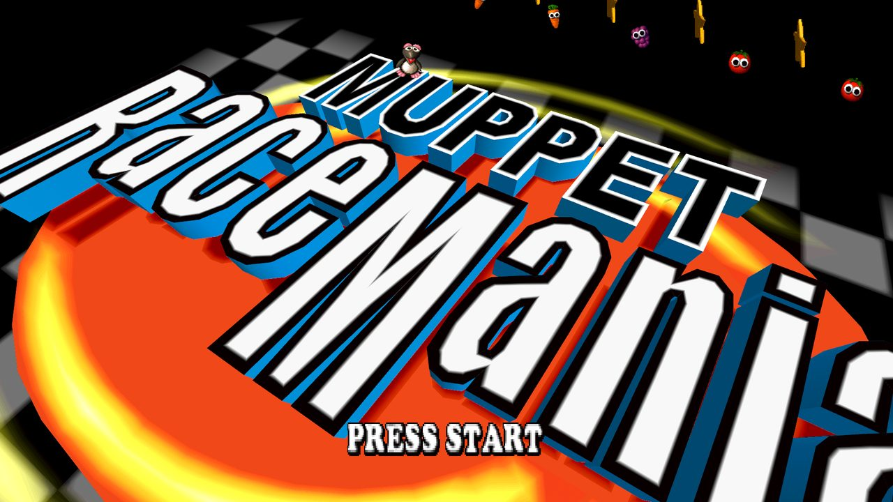
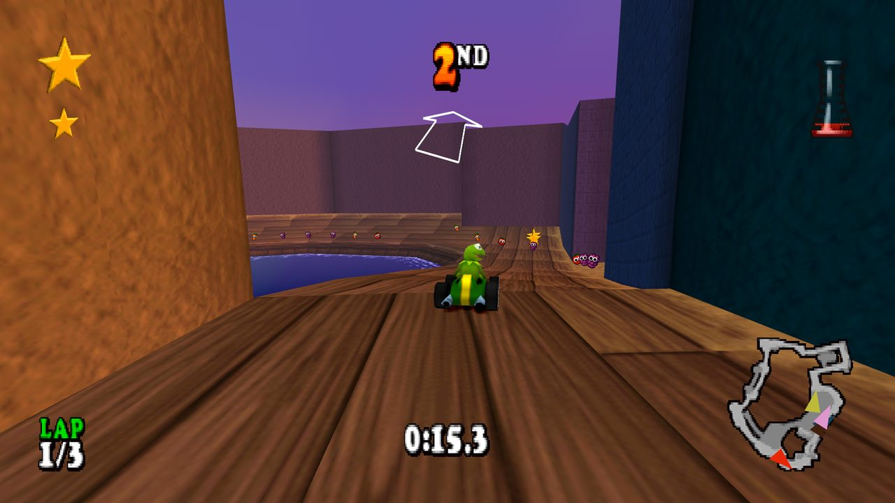
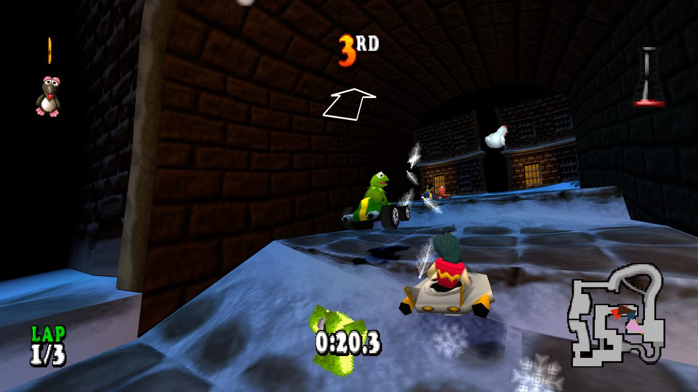
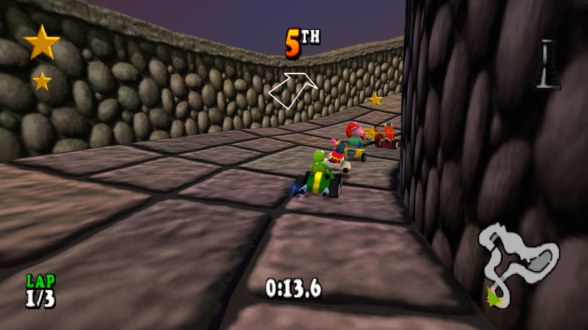
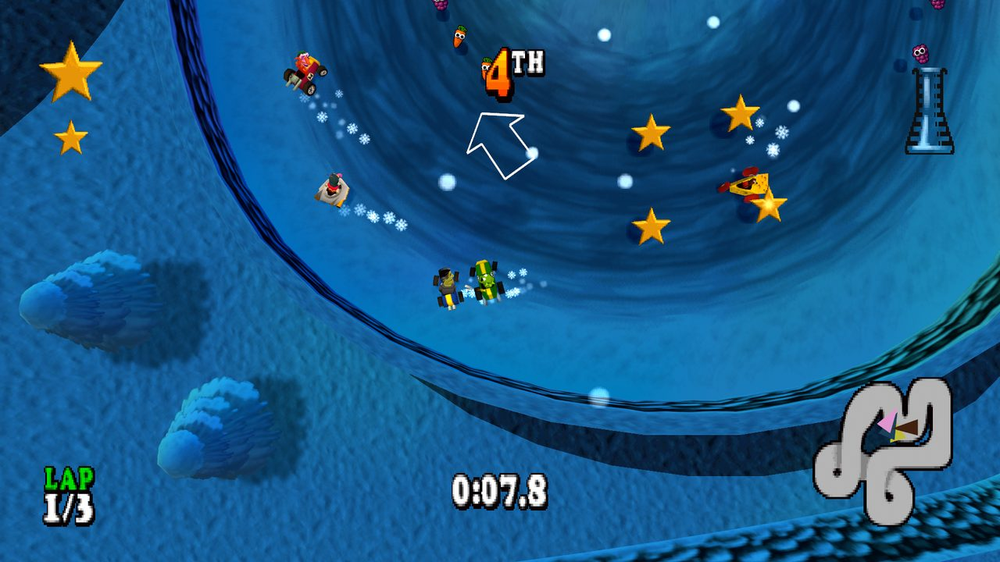
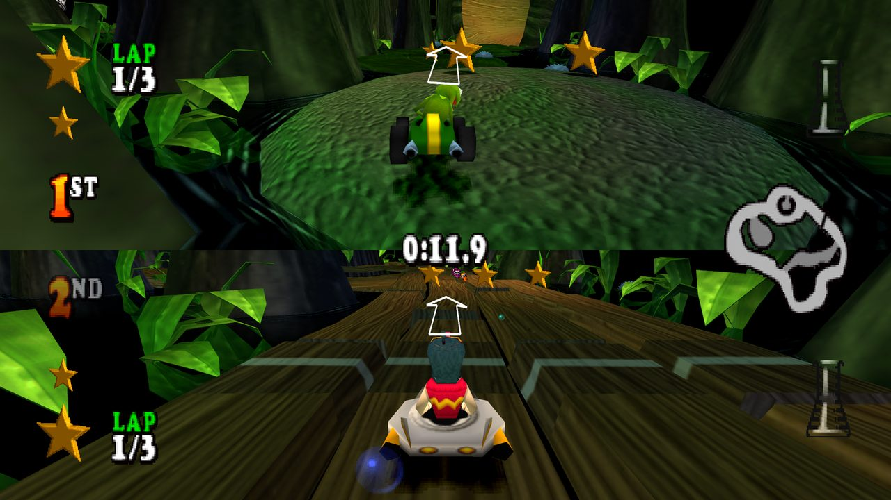
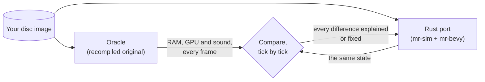

<div align="center">

# RustMania Racing

**A from-scratch Rust reimplementation of *Muppet RaceMania*, the 2000
PlayStation kart racer, built with the Bevy engine and checked tick for tick
against the original.**



</div>

Every course, mode, menu, movie and sound of *Muppet RaceMania* (PS1, USA) runs
natively on Windows: a modern, widescreen, 60 Hz game that still plays like the
original. The code is all new; the game's art, music and data are read at run
time from **your own disc**. Nothing from the game is in this repository.

<table>
<tr>
<td></td>
<td></td>
</tr>
<tr>
<td></td>
<td></td>
</tr>
<tr>
<td colspan="2" align="center"></td>
</tr>
</table>

## What's in it

- **The whole game.** 18 race courses, 10 battle arenas and 6 stunt courses;
  tournaments, ADVENTURE, the course secrets (boss challenges, reverse races,
  dogfights, Doozer battles), two-player split screen and Chicken Chase, MEET
  THE MUPPETS with its test drive, the attract demo, the credits, the cheat
  codes, saves and unlocks.
- **The original's feel.** Kart physics, AI, items, cameras and race rules are
  ported from the game's own code with its integer arithmetic, so a race runs
  the same way it did on the PlayStation.
- **Its sound and movies.** Engine, effects and voice clips through a model of
  the PlayStation's sound chip; the CD music streamed from the disc; all 30
  movies decoded in Rust.
- **Modern options, all switchable back.** Native widescreen with the HUD
  pinned to the edges, 60 Hz logic with lower input latency, the whole course
  drawn with no pop-in, MSAA, smooth texture filtering, a subtle distance haze,
  keyboard and gamepads with rumble. One setting (`faithful_view`) restores
  the PlayStation look.

## Playing it

You need your own copy of the game: a `.cue`/`.bin` image of
*Muppet RaceMania (USA)* (SLUS-01237) made from your disc. A `.chd` can be
converted with `chdman`.

1. Get `muppet-racemania.exe`: download a release, or build it (below).
2. Run it. The first time, it asks where your `.cue` is; paste the path and
   press Enter. It checks the image against the known good dump and remembers
   it.
3. Race. Saves and settings live in `%APPDATA%\MuppetRaceMania\`.

| | Keyboard | Gamepad |
|---|---|---|
| Steer | Arrows | D-pad / left stick |
| Accelerate | X | A / Cross, or right trigger |
| Brake / reverse | S | B / Circle, or left trigger |
| Jump | Z | X / Square |
| Camera lock-on, menu back | A | Y / Triangle |
| Items: L1 / R1 / L2 / R2 | Q / W / E / R | bumpers / stick clicks |
| Pause | Enter | Start |

Player 2 uses a second pad, or the keyboard's right side (`port/README.md`).

## How it was made

The port was built against a working copy of the original. The PlayStation
program was first recompiled to native code with
[PSXRecomp](https://github.com/RetroPortingToolKit/psxrecomp); that build,
with a small debug plugin, became the **oracle**. It replays recorded inputs
frame-exactly and hands over its memory every frame. Each subsystem was then
rewritten in plain Rust and compared with the oracle until the numbers matched.



The simulation (`mr-sim`) is integer-only and deterministic, so a whole race,
random numbers included, can be checked against a recording. Some results:

| Area | Check against the original |
|---|---|
| All 18 race courses | race start and every kart, camera and random number exact for the full recording (~1,600 frames each) |
| Items and AI | six karts free-running exact over 4,815 ticks; 308 / 308 item sound triggers |
| Battle, stunt, adventure, secrets, two players | every mode's recordings exact, both players and cameras included |
| HUD and menus | the game's own draw commands matched primitive for primitive (e.g. 9,714 / 9,714 race HUD sprites) |
| Movies | every decoded frame region byte-identical to the original's video memory |
| Robustness | 22 million fuzzed ticks across every mode at 30 and 60 Hz, no crashes |

Every place the port differs on purpose (60 Hz, per-pixel depth instead of the
PS1's draw order, widescreen) is written down in the ledgers in `docs/spec/`.

<div align="center">

</div>

The work ran in eight sessions with [Claude Code](https://claude.com/claude-code)
doing the reverse-engineering, porting and verification under the author's
direction. The session briefs, plans and daily logs are kept in
`docs/history/`.

## Building

Requires Rust (the toolchain is pinned in `port/rust-toolchain.toml`) on
Windows 10/11 x64.

```
cd port
cargo run --release -p mr-bevy
```

`tools\package-port.ps1` makes the stand-alone zip: a windowed exe with the C
runtime built in, a readme and the third-party licences, and no game data.
`cargo test --workspace` runs the test suite; tests that need recordings of the
original skip themselves when those are absent.

## Repository layout

| Path | What |
|---|---|
| `port/` | The game: a Cargo workspace. `mr-disc` (disc image), `mr-assets` (models, textures, courses), `mr-audio` (sound chip, CD audio), `mr-video` (movies), `mr-sim` (the game logic), `mr-bevy` (the app), `mr-trace` (comparison tools) |
| `docs/spec/` | How the game works, subsystem by subsystem, with the original's code addresses, plus the ledgers of every deliberate difference |
| `docs/FINAL-REPORT.md` | The full verification report |
| `docs/history/` | Session briefs, plans and logs from the build |
| `tools/oracle/` | Capture and comparison scripts used against the oracle |
| `game.toml`, `src/mods/`, `psxrecomp/` | The PSXRecomp project that builds the oracle (development only) |

## License

The code in this repository is dual-licensed under [MIT](LICENSE-MIT) or
[Apache-2.0](LICENSE-APACHE), at your option. The `psxrecomp` and `recomp-ui`
submodules, and the oracle project files generated from their templates, keep
their own licence (PolyForm Noncommercial 1.0.0; see `psxrecomp/LICENSE`).

---

<sub>*Muppet RaceMania* was developed by Traveller's Tales and published in
2000; the Muppets characters and names are trademarks of their owners
(The Muppets Studio / Disney). This is an unofficial, non-commercial fan
project made out of affection for the game and the people who created it. It
is not affiliated with, endorsed by or sponsored by any of them. The repository
contains no game code, art, audio or other game data; the screenshots show
the port running on the author's own copy. To play, you need your own legally
obtained disc.</sub>
